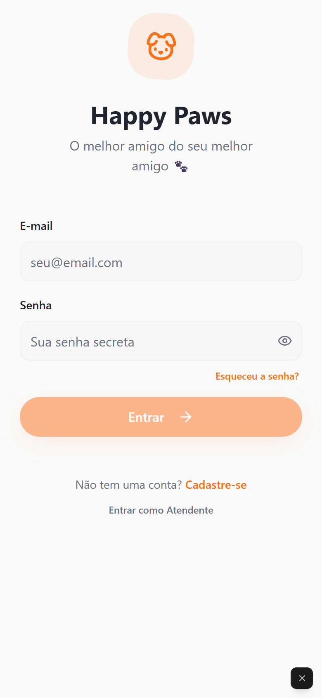
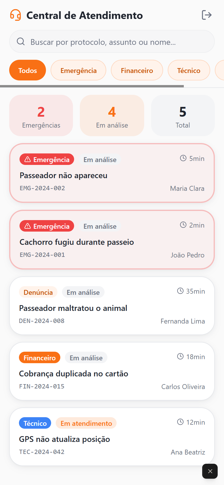

# Happy Paws

Plataforma de intermediação entre tutores de cães e passeadores (*dog walkers*).
Este repositório tem o **protótipo navegável** (React + Vite + shadcn/ui, em `src/`),
publicado em <https://happypawss.lovable.app>, e a **documentação das duas disciplinas**
em que o sistema foi trabalhado na UFES:

- 📄 **[`docs/`](docs/) — índice da documentação**
  - [`docs/es1-requisitos/`](docs/es1-requisitos/) — Engenharia de Software I (2025/2):
    requisitos, user stories, critérios de aceitação e modelagem conceitual.
  - [`docs/es2-projeto/`](docs/es2-projeto/) — Engenharia de Software II (2026/2):
    projeto do sistema (arquitetura, CDP, CGT, CIU), protótipo de alta fidelidade e
    fontes LaTeX do documento de projeto.

<p align="center">
  
  &nbsp;&nbsp;
  
</p>

## O protótipo

**[Abrir o protótipo →](https://happypawss.lovable.app)**

É um protótipo **não funcional**: não há backend e os dados são de exemplo. Qualquer e-mail e senha
entram como tutor, e **Entrar como Atendente** abre a central de atendimento.

Telas: entrada e cadastro, busca e perfil de passeadores, agendamento, acompanhamento do passeio,
foto do passeio, avaliação, perfil do pet, suporte e a central de atendimento (tickets de emergência,
denúncia, financeiro e técnico).

## Como foi construído

O protótipo foi gerado com o **[Lovable](https://lovable.dev)** (*vibe coding*) a partir dos requisitos
e das user stories de ES1 e depois ajustado pela equipe, em prompts e à mão (a tela de passeio unificada,
o pagamento, a foto do passeio e o fluxo de emergência). É um trabalho em equipe das disciplinas de
Engenharia de Software da UFES.

## Rodar localmente

Requer Node.js 18 ou mais recente.

```sh
npm install
npm run dev      # servidor de desenvolvimento (Vite)
npm test         # testes (Vitest)
```

Stack: Vite, React, TypeScript, Tailwind CSS e shadcn/ui.
